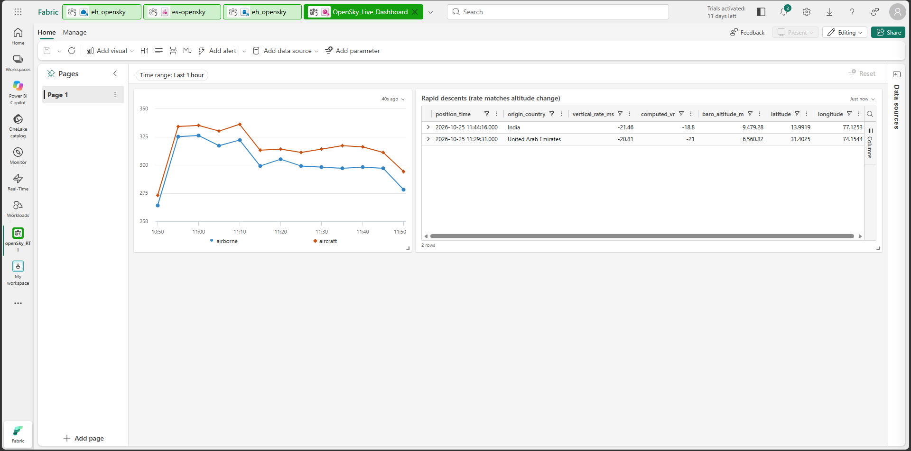
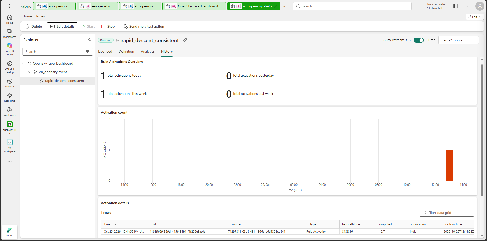

# Live aircraft data in Microsoft Fabric Real-Time Intelligence

A small portfolio project: live aircraft positions from the OpenSky Network API, streamed into a Fabric Eventhouse, analysed with KQL, shown on a Real-Time Dashboard, with an Activator rule on top. I built it in one session on 25 Oct 2026 on a Fabric trial, as a streaming counterpart to my batch work (a medallion lakehouse on BTS airline data: https://github.com/siamsadman/bts-fabric-pipeline).

This README says only what I built and ran. Where something failed, was partial or was not checked, it says so (see "Problems, limits and what I did not verify"). All times are UTC unless stated; Dhaka is UTC+6.

Data: OpenSky Network (https://opensky-network.org), used under their API terms. This is a non-commercial portfolio project.

## Architecture

```
OpenSky REST API (/states/all, bounding box lat 5-35, lon 60-100)
      |  OAuth2 client credentials, producer set to poll every 60 s
Python producer (producer/opensky_producer.py)
      |  one JSON event per aircraft, Event Hubs protocol
Eventstream es-opensky (custom endpoint source)
      |  Eventhouse destination, direct ingestion, JSON
Eventhouse eh_opensky -> KQL table aircraft_states
      |-- KQL function aircraft_clean() and analysis queries
      |-- Real-Time Dashboard OpenSky_Live_Dashboard (2 tiles)
      '-- Activator rule rapid_descent_consistent
```

Why a producer script: OpenSky now requires OAuth2 client credentials. The Eventstream HTTP source (preview) is documented with Anonymous, Basic and API key authentication and says OAuth is not supported, so I used a script and an Eventstream custom endpoint. I did not test the HTTP source.

## What I built and ran

- **Producer** (Python 3.14.6, azure-eventhub 5.15.1, requests 2.34.2, python-dotenv 1.2.4): gets an OAuth2 token, refreshes it before it expires, calls `/states/all` for the box above, names the fields of each aircraft, and sends one JSON event per aircraft. Per the OpenSky docs, a call on a box this size costs 4 credits, and a standard account gets 4,000 credits a day.
- **Eventstream and Eventhouse:** a custom endpoint source, an Eventhouse destination with direct ingestion, and a KQL database. The destination setup created the table `aircraft_states`.
- **KQL:** a saved function `aircraft_clean()` (typed datetimes, one row per aircraft and position time) and the queries listed below.
- **Real-Time Dashboard** `OpenSky_Live_Dashboard` with two tiles.
- **Activator rule** `rapid_descent_consistent`.

## The data (queried 13:37 UTC, after I stopped the producer)

| Measure | Value |
|---|---|
| Rows ingested (raw events) | 54,587 |
| First / last event received | 10:16:14 / 13:34:39 UTC (3 h 18 min, with gaps) |
| Unique positions after `aircraft_clean()` | 46,004 |
| Rows removed by `aircraft_clean()` | 8,583 (about 15.7 percent), mostly repeated positions |
| Distinct aircraft | about 1,086 (`dcount` estimate) |

I stopped and restarted the producer once, at about 10:40 UTC. "Rows" means ingested events, not distinct readings or aircraft. Each poll resends aircraft that have not reported a new position, which is why repeats exist: in an earlier sample, 1,855 of 11,257 raw rows were repeated positions and none lacked a position.

## KQL in this repo

| File | Contents |
|---|---|
| `kql/00_verify_ingestion.kql` | table list, schema, row count, row count with time range |
| `kql/01_functions.kql` | `aircraft_clean()` |
| `kql/02_dedup_breakdown.kql` | raw rows split into unique positions and repeats |
| `kql/03_analysis.kql` | Q1 aircraft per 5 minutes, Q2 top origin countries, Q3a vertical-rate distribution, Q3b emergency squawk codes, Q4 threshold frequency, Q5 altitude consistency, Q6 data gaps, Q7 final counts |
| `kql/04_dashboard_tiles.kql` | the two dashboard tile queries |

What I saw on this data (times are when I ran each query):
- **Aircraft per 5 minutes:** roughly 250 to 350 distinct aircraft per window while the producer was running, with dips where it was stopped or failing.
- **Top origin countries (11:06 UTC, before collection ended):** India 408 distinct aircraft, UAE 47, Thailand 44, China 25, Bangladesh 24. `origin_country` is inferred from the transponder address per the OpenSky docs, so it is registration country, not where the aircraft was flying.
- **Vertical rate of airborne readings (11:12 UTC, 14,104 readings):** median 0 m/s, 5th to 95th percentile about -8.8 to +9.7 m/s, extremes -44.87 and +26.33 m/s.
- **Emergency squawk codes 7500, 7600, 7700:** no rows when I ran the query at 11:14 UTC. I did not re-run it on the full table.
- **Rapid-descent frequency (11:19 UTC, 15,938 airborne readings):** 71 below -15 m/s, 8 below -20 m/s, 5 below -25 m/s.
- **Consistency check:** of 12 readings reported below -20 m/s, 2 agreed with the rate calculated from the altitude change between consecutive readings (within 5 m/s, a tolerance I chose); 10 did not. Small sample, and I did not investigate why they disagree.

## Dashboard

Tile 1 shows distinct aircraft per 5 minutes and honours the dashboard time range. Tile 2 lists airborne readings below -20 m/s whose reported vertical rate is within 5 m/s of the rate calculated from the altitude change. I first built tile 2 on the reported rate alone, then found most hits looked inconsistent with altitude, so I tightened it (screenshots 12 and 14).



## Alert rule

`rapid_descent_consistent` was created from tile 2: the query runs every 5 minutes, the condition is `vertical_rate_ms` less than -20, and the action is a Teams message to my own account. The rule showed **Running**. At about 13:03 UTC the History tab showed **1 recorded activation** (12:44:52 UTC, a borderline case: reported -21.46 m/s against -16.7 m/s calculated from altitude). The live feed listed 3 matching rows at about 12:48 UTC; the other two arrived before I corrected the condition. I did not re-check History after 13:03 UTC.

**Notification delivery is not verified.** The account has no working mailbox or Teams subscription. The email test failed with "email address is not defined in your profile", and a Teams subscription error was shown. I did not determine whether Activator records an activation when delivery fails.



## Problems, limits and what I did not verify

- **Data gaps:** the data is not a continuous 60-second series. Seven gaps longer than 90 seconds, up to 431 seconds, are listed in `docs/problems-log.md`. Two match producer timeouts on 19:17 to 19:27 Dhaka time; the other five (12:13 to 12:43 UTC) are unexplained.
- **Producer timeouts:** one ReadTimeout and several ConnectTimeouts calling OpenSky; the script logs the error and tries again at the next interval and recovered each time. Cause not determined (OpenSky or my network). The script has no retry logic of its own.
- **Events before the destination existed:** a test run of 321 events was sent before the Eventhouse destination was added. The table's first event is 10:16 UTC, so those events appear not to have been stored (inferred from timestamps).
- **Rapid-descent flag is a data check, not a safety signal.** Many reported rapid descents looked inconsistent with altitude, which could be bad values, and I did not establish what actually happened.
- **Mistakes I made and fixed:** the first dashboard tile ignored the time-range filter, so its label did not match its data; the Activator rule first saved with the operator "is equal to" instead of "is less than"; I first counted live-feed rows as activations; my first sanitising pass on the dashboard export missed one identifier. All are in the log.
- **Not tested:** the Eventstream HTTP source, ingestion latency, setting the project up from scratch on another machine, and a Power BI report on the Eventhouse.
- **The producer script has local paths hard-coded** (for credentials and the connection string, kept outside this repo).

## After the Fabric trial

The Fabric items (Eventstream, Eventhouse, dashboard, Activator rule) will not exist after the trial ends, and the live parts need a Fabric capacity to re-run. What stays in this repo: the producer script, the KQL scripts, schema notes (`docs/schema-notes.md`), a sanitized dashboard export (`fabric-export/`: dashboard, workspace, database and cluster identifiers replaced with placeholders; the 13 tile, query, page and data-source IDs generated inside the dashboard file were left as they are; no working data source), the problems log (`docs/problems-log.md`) and screenshots.

## Screenshots

| # | Shows |
|---|---|
| 01, 02 | Eventhouse and Eventstream created |
| 03 | Eventstream live view with data preview |
| 04 | early row count and time range |
| 05 | repeated positions vs unique positions |
| 06, 07 | aircraft per 5 minutes; top origin countries |
| 08, 09, 10 | vertical-rate distribution; emergency squawk check (empty result); threshold frequency |
| 11, 12, 14 | dashboard: first tile; two tiles with the simple rule; stricter tile 2 |
| 13 | consistency check of reported descents |
| 15, 16, 17, 18 | Activator rule; test action error; notification errors; history |
| 19 | producer terminal: timeouts and recovery |
| 20, 21 | data gaps; final counts |

Screenshots were taken in the Fabric UI on 25 Oct 2026.
